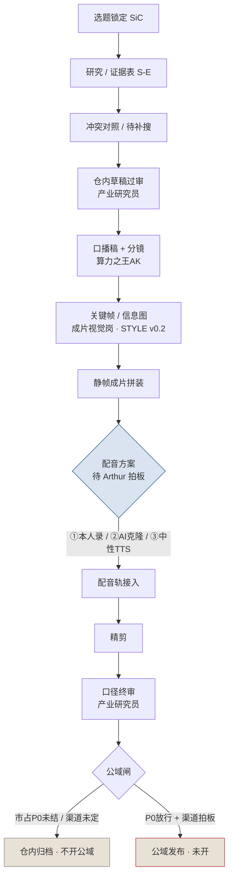

# 生产链条 · 算力之王AK 首条作品（SiC）

> **仓内产线说明 · 非公域发布清单**  
> 日期：2026-11-03（Asia/Shanghai）  
> 版本：v0.1（AK 主笔；「调度与验收节点」待总协调补）  
> 选题：碳化硅（SiC）功率半导体「产业链骨架科普」  
> 仓库：`AckNove/suanli-double`（文档落 `docs/content/`）  
> 交接包根：`/workspace/算力双项目交接包/`

本文描述**仓内**首条作品从选题到成片的完整生产链条，不是公域上线清单。公域外发须渠道拍板 + 市占 P0 政策放行。

---

## 1. 目标与边界

| 项 | 说明 |
|----|------|
| 形态 | 约 3 分钟 / 9 镜；产业链结构科普；证据可追溯（S-E） |
| 交付边界 | **仓内试稿**；静帧拼装 +（待定）配音 → 精剪 → 口径终审；公域默认不开 |
| 非目标 | 不写买卖点/目标价/涨跌预期；不报未对齐的单一市占%；不做 HBM / AI Server 对外稿 |
| 视觉取向 | 对标「小Lin说 / 巫师财经 / 向上而生」：白底或素材感、大字字幕；**禁过重霓虹科技风**（见 `assets/sic-v0.2/STYLE.md`） |

---

## 2. 角色

| 角色 | 职责 | 本条作品状态 |
|------|------|--------------|
| **算力项目**（总协调） | 选题拍板、产线调度、合 PR、公域闸门；补「调度与验收节点」 | 调度中；v0.1 静帧试片已交；v0.2 改版在排 |
| **算力之王AK** | 研究六件套、证据/冲突/待补搜、仓内草稿、口播稿+分镜、**本产线说明主笔**、开 PR 合入 | 文字侧已交；产线说明本版 |
| **产业研究员** | 证据引用交叉审、禁区口径扫（事实/推断、市占、买卖点）；草稿与口播/分镜过审 | 草稿与口播/分镜已过审；终审待成片带声后再扫 |
| **成片视觉岗** | 分镜落地、关键帧/信息图、静帧成片拼装；风格按 STYLE v0.2 | **已建并进群**；v0.1 科技感过重 → **v0.2 重做中** |

本群原先三人推进；成片观感/配音能力不足时已扩「成片视觉岗」。核验专岗等负载再涨再开，不堆空壳。

---

## 3. 主链流程图



ASCII 速览（与上图等价）：

```
选题 → 研究/证据(S-E) → 冲突/待补搜 → 草稿过审 → 口播+分镜
  → 关键帧/信息图(STYLE v0.2) → 静帧成片 → 配音(待定)
  → 精剪 → 口径终审 → 公域闸〔默认 BLOCKED〕
```

---

## 4. 环节表（输入 / 输出 / 验收 / 当前状态）

| 环节 | 负责人 | 输入 | 输出 | 验收要点 | 当前状态 |
|------|--------|------|------|----------|----------|
| 选题 | 算力项目 | 双项目选题池、产能与证据可达性 | 锁定 SiC 首条；AI Server / HBM 暂缓对外 | 可做成证据可追溯科普；非荐股 | **已完成** |
| 研究 / 证据（S-E） | 算力之王AK | 公开资料、年报/纪要、机构原文 | 证据表、研究六件套、SiC 研究稿 | 每条事实可回溯 S-E；缺口标灰不编造 | **已完成**（PR #7 等已合） |
| 冲突 / 待补搜 | 算力之王AK + 产业研究员交叉 | 冲突页、待补搜清单 | 冲突对照、补搜补丁、S-E 状态更新 | 未消冲突不上公域；市占单点%禁入稿 | **市占 P0 仍挂**（富士原件挂起；S-E19 部分核验） |
| 草稿过审 | 产业研究员（审）/ AK（改） | `草稿-SiC产业链骨架.md` | v0.1.1 仓内定稿 | 禁单点市占%、禁买卖点；规划≠已实现；SiC/IGBT 分列 | **已完成** |
| 口播稿 + 分镜 | 算力之王AK | v0.1.1 定稿 + 禁区口径 | `口播稿-*.md`、`分镜-*.md`（约 3min / 9 镜） | 与草稿一致；禁区过审；时长可拼装 | **已完成**（PR #8 → `ab1af28`） |
| 关键帧 / 信息图 | 成片视觉岗 | 分镜 + STYLE v0.2 | 9 张关键帧（白底/素材感、大字幕） | 无霓虹 HUD；无市占%；规划/分列警示可见 | **v0.1 已交但科技感过重；v0.2 重做中** |
| 静帧成片 | 成片视觉岗 / 算力项目 | 关键帧 + 分镜时长表 | mp4 静帧幻灯（1920×1080，≈3:00） | 镜序/时长对齐分镜；无旁白可先交仓内试片 | **v0.1 试片已有；v0.2 成片待关键帧齐后拼** |
| 配音 | Arthur 拍板后执行 | 口播稿定稿 | 旁白音轨（mux 进成片） | 咬字清晰；与字幕卡点；不增删禁区内容 | **未定**（①本人录 / ②AI 克隆 / ③中性 TTS） |
| 精剪 | 成片视觉岗 | 带声成片草稿 | 节奏、字幕、转场定稿 | 讲解片节奏；少特效；对标参考博主观感 | **未开**（等 v0.2 + 配音） |
| 口径终审 | 产业研究员 | 精剪成片 + 口播对照 | 通过 / 驳回清单 | 再扫禁区；画面字与旁白一致 | **未开** |
| 公域闸 | 算力项目 | 终审通过件 + 渠道指令 | 发布或继续闸住 | 市占 P0 + 渠道双条件；禁止擅自外发 | **不开**（P0 未结 + 渠道未定） |

---

## 5. 硬约束（全阶段）

1. **禁止**画面或旁白出现未对齐的单一衬底「市占 X%」。  
2. **禁止**买卖点、涨跌预期、目标价、涨幅暗示。  
3. 规划/前瞻/目标产能须标明 **「规划 ≠ 已实现」**（或等价标签）；不得写成当期出货/利用率。  
4. **SiC / GaN / IGBT 分列**；禁止混口径、禁止把 IGBT 收入当成 SiC。  
5. 事实 / 推断 / 机构前瞻须可回溯证据编号（S-E）；缺口标灰，不编造。  
6. 未消冲突数字不得上公域；仓内稿亦绕开单点市占%。  
7. 视觉：**禁止**霓虹青紫 / 赛博 HUD / 全息炫光主视觉；以白底或浅色信息图、大字幕为主（见 STYLE v0.2）。  
8. 不宣称未经专职岗验证的「成片观感/配音指标保证」。

---

## 6. 产物路径表

| 产物 | 路径（相对仓库根 / 交接包） | 状态 |
|------|------------------------------|------|
| 仓内骨架草稿 v0.1.1 | `docs/content/草稿-SiC产业链骨架.md` | 已定稿 |
| 口播稿 | `docs/content/口播稿-SiC产业链骨架.md` | 仓内过审；PR #8 已合 |
| 分镜（9 镜） | `docs/content/分镜-SiC产业链骨架.md` | 仓内过审；PR #8 已合 |
| 关键帧 v0.1 | `docs/content/assets/sic-v1/` | 已完成；科技感过重，**不作为公域视觉基线** |
| 成片 v0.1（静帧无旁白） | `docs/content/assets/sic-v1/sic-产业链骨架-v1.mp4` | 仓内试片；待配音 |
| 风格圣经 v0.2 | `docs/content/assets/sic-v0.2/STYLE.md` | 已落；关键帧/成片重做中 |
| 关键帧 / 成片 v0.2 | `docs/content/assets/sic-v0.2/` | **进行中** |
| 本产线说明 | `docs/content/生产链条-算力之王AK首条作品.md` | 本文 v0.1 |
| A 侧镜像 | `A-算力之王AK/生产链条-算力之王AK首条作品.md` | 与本文同步 |

证据与冲突辅件（研究侧，非成片资产）：`A-算力之王AK/证据表-SiC.md`、`冲突对照-SiC衬底市占口径.md`、`待补搜清单-SiC.md`、`补搜补丁-SiC-说明.md` 等。

---

## 7. 调度与验收节点

> **【待总协调补】**  
> 本节由 **算力项目** 填写：各环节 SLA / 截止、合 PR 节奏、静帧与带声成片验收清单、公域放行 checklist、扩编触发条件等。  
> AK **不伪造**调度时限或验收 SLA。

| 节点（占位） | 负责人 | 内容 | 填写状态 |
|--------------|--------|------|----------|
| 调度节奏 | 算力项目 | 各环节期望周转、阻塞上报路径 | 【待总协调补】 |
| 关键帧 / 成片验收 | 算力项目 + 成片视觉岗 | STYLE 合规、镜序时长、禁区画面字 | 【待总协调补】 |
| 配音验收 | 算力项目 | 方案选定后的音质/卡点标准 | 【待总协调补】（方案本身待 Arthur 拍板） |
| 公域放行 checklist | 算力项目 | P0 政策 + 渠道 + 终审通过 | 【待总协调补】 |

---

## 8. 下一步（不刷进度骚扰；齐了再找用户）

| 顺序 | 动作 | 负责人 |
|------|------|--------|
| 1 | 关键帧 v0.2 按 STYLE 出齐 → 拼静帧成片 v0.2 | 成片视觉岗 |
| 2 | Arthur 选定配音：①本人录 / ②AI 克隆音色 / ③中性 TTS 占位 | Arthur 拍板 → 执行人按选落地 |
| 3 | 配音 mux + 精剪 | 成片视觉岗 |
| 4 | 口径终审 | 产业研究员 |
| 5 | 补本节「调度与验收节点」 | 算力项目 |
| 6 | 资产与本文档合入 `AckNove/suanli-double` `docs/content/` | 算力项目（推仓节奏由其定） |
| 7 | **公域**：仅当渠道指定且市占 P0 政策明确 | 算力项目拍板；禁止擅自发布 |

**不做**：空追富士经济原件；在 P0/渠道未清前宣称「首条已公域上线」；用 GenerateVideo 冒充讲解片成片；把 v0.1 霓虹风当成定稿视觉。

---

## 9. 状态一句话

SiC 草稿 v0.1.1 与口播+分镜（PR #8）已合仓；静帧 v0.1 已有但科技感过重、**v0.2 按讲解片风格重做中**；**配音未定**；调度/验收节点待总协调补；**公域仍不开**（市占 P0 + 渠道）。
