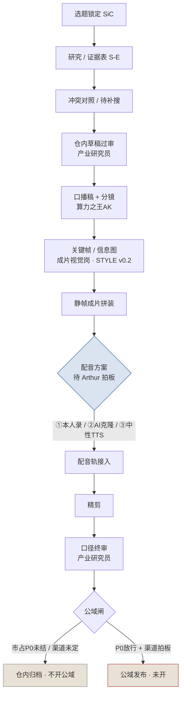

# 生产链条 · 算力之王AK 首条作品（SiC）

> **仓内产线说明 · 非公域发布清单**  
> 日期：2026-11-03（Asia/Shanghai）  
> 版本：v0.1.1（AK 主笔主链；§7 调度与验收由算力项目补完；视觉资产状态同步至 v0.2 已交）  
> 选题：碳化硅（SiC）功率半导体「产业链骨架科普」  
> 仓库：`AckNove/suanli-double`（文档落 `docs/content/`）  
> 交接包根：`/workspace/算力双项目交接包/`  
> 视觉资产：**v0.2 现行**已落 `docs/content/assets/sic-v0.2/`（`01`–`09` jpg、`STYLE.md`、`README.md`、`sic-产业链骨架-v0.2.mp4`，160s / 1920×1080，无旁白）；v0.1 霓虹风保留在 `docs/content/assets/sic-v1/` 作对照

本文描述**仓内**首条作品从选题到成片的完整生产链条，不是公域上线清单。公域外发须渠道拍板 + 市占 P0 政策放行。

---

## 1. 目标与边界

| 项 | 说明 |
|----|------|
| 形态 | 约 2:40–3:10 / 9 镜；**v0.2 现行静帧 160s（2:40）** / 1920×1080、无旁白；产业链结构科普；证据可追溯（S-E） |
| 交付边界 | **仓内试稿**；静帧拼装 +（待定）配音 → 精剪 → 口径终审；公域默认不开 |
| 非目标 | 不写买卖点/目标价/涨跌预期；不报未对齐的单一市占%；不做 HBM / AI Server 对外稿 |
| 视觉取向 | **现行 v0.2** 对标「小Lin说 / 巫师财经 / 向上而生」：米白/白板讲解片、大字字幕、扁平示意（`docs/content/assets/sic-v0.2/STYLE.md`）。**v0.1 霓虹/科技 HUD 保留在 `docs/content/assets/sic-v1/` 作对照**，不作为现行视觉 |

---

## 2. 角色

| 角色 | 职责 | 本条作品状态 |
|------|------|--------------|
| **算力项目**（总协调） | 选题拍板、产线调度、合 PR、公域闸门；补「调度与验收节点」 | 调度中；**v0.2 静帧试片已交仓**；v0.1 留 `sic-v1` 对照；公域仍闸 |
| **算力之王AK** | 研究六件套、证据/冲突/待补搜、仓内草稿、口播稿+分镜、**本产线说明主笔**、开 PR 合入 | 文字侧已交；产线说明本版 |
| **产业研究员** | 证据引用交叉审、禁区口径扫（事实/推断、市占、买卖点）；草稿与口播/分镜过审 | 草稿与口播/分镜已过审；终审待成片带声后再扫 |
| **成片视觉岗** | 分镜落地、关键帧/信息图、静帧成片拼装；风格按 STYLE v0.2 | **已建并进群**；**v0.2 九镜与静帧成片已落** `docs/content/assets/sic-v0.2/` |

本群原先三人推进；成片观感/配音能力不足时已扩「成片视觉岗」。核验专岗等负载再涨再开，不堆空壳。

---

## 3. 主链流程图



ASCII 速览（与上图等价）：

```
选题 → 研究/证据(S-E) → 冲突/待补搜 → 草稿过审 → 口播+分镜
  → 关键帧/信息图(STYLE v0.2) → 静帧成片 → 配音(待定)
  → 精剪 → 口径终审 → 公域闸〔默认 BLOCKED〕
```

### 3.1 视觉风格枢转（v0.1 → v0.2）

| | v0.1（对照，保留） | v0.2（现行） |
|--|-------------------|--------------|
| 触发 | 首条试出 | Arthur：科技感过重 / 审美疲劳 |
| 参考向 | 信息图 HUD | 小Lin说 · 巫师财经 · 向上而生 |
| 视觉 | 偏霓虹/科技卡 | 米白/白板 · 大字字幕 · 扁平示意 |
| 资产根 | `docs/content/assets/sic-v1/` | `docs/content/assets/sic-v0.2/` |
| 风格圣经 | — | `docs/content/assets/sic-v0.2/STYLE.md` |
| 成片 | `sic-产业链骨架-v1.mp4`（≈3:00） | `sic-产业链骨架-v0.2.mp4`（**160s / 2:40**，无旁白） |

硬约束不变：禁市占单点%；规划须标「≠已实现」；SiC/GaN/IGBT 分列；禁买卖点。v0.1 目录不删，只作对照。

---

## 4. 环节表（输入 / 输出 / 验收 / 当前状态）

| 环节 | 负责人 | 输入 | 输出 | 验收要点 | 当前状态 |
|------|--------|------|------|----------|----------|
| 选题 | 算力项目 | 双项目选题池、产能与证据可达性 | 锁定 SiC 首条；AI Server / HBM 暂缓对外 | 可做成证据可追溯科普；非荐股 | **已完成** |
| 研究 / 证据（S-E） | 算力之王AK | 公开资料、年报/纪要、机构原文 | 证据表、研究六件套、SiC 研究稿 | 每条事实可回溯 S-E；缺口标灰不编造 | **已完成**（PR #7 等已合） |
| 冲突 / 待补搜 | 算力之王AK + 产业研究员交叉 | 冲突页、待补搜清单 | 冲突对照、补搜补丁、S-E 状态更新 | 未消冲突不上公域；市占单点%禁入稿 | **市占 P0 仍挂**（富士原件挂起；S-E19 部分核验） |
| 草稿过审 | 产业研究员（审）/ AK（改） | `草稿-SiC产业链骨架.md` | v0.1.1 仓内定稿 | 禁单点市占%、禁买卖点；规划≠已实现；SiC/IGBT 分列 | **已完成** |
| 口播稿 + 分镜 | 算力之王AK | v0.1.1 定稿 + 禁区口径 | `口播稿-*.md`、`分镜-*.md`（约 3min / 9 镜） | 与草稿一致；禁区过审；时长可拼装 | **已完成**（PR #8 → `ab1af28`） |
| 关键帧 / 信息图 | 成片视觉岗 | 分镜 + STYLE v0.2 | 9 张关键帧（白底/素材感、大字幕） | 无霓虹 HUD；无市占%；规划/分列警示可见 | **v0.2 已交**（`docs/content/assets/sic-v0.2/` `01`–`09`）；v0.1 霓虹风留 `sic-v1` 对照 |
| 静帧成片 | 成片视觉岗 / 算力项目 | 关键帧 + 分镜时长表 | `sic-产业链骨架-v0.2.mp4`（1920×1080，**160s**，无旁白） | 镜序/时长对齐分镜；无旁白可先交仓内试片 | **v0.2 已交**；v0.1 试片保留于 `sic-v1/` |
| 配音 | Arthur 拍板后执行 | 口播稿定稿 | 旁白音轨（mux 进成片） | 咬字清晰；与字幕卡点；不增删禁区内容 | **未定**（①本人录 / ②AI 克隆 / ③中性 TTS） |
| 精剪 | 成片视觉岗 | 带声成片草稿 | 节奏、字幕、转场定稿 | 讲解片节奏；少特效；对标参考博主观感 | **未开**（v0.2 静帧已交，等配音） |
| 口径终审 | 产业研究员 | 精剪成片 + 口播对照 | 通过 / 驳回清单 | 再扫禁区；画面字与旁白一致 | **未开** |
| 公域闸 | 算力项目 | 终审通过件 + 渠道指令 | 发布或继续闸住 | 市占 P0 + 渠道双条件；禁止擅自外发 | **不开**（P0 未结 + 渠道未定） |

---

## 5. 硬约束（全阶段）

1. **禁止**画面或旁白出现未对齐的单一衬底「市占 X%」。  
2. **禁止**买卖点、涨跌预期、目标价、涨幅暗示。  
3. 规划/前瞻/目标产能须标明 **「规划 ≠ 已实现」**（或等价标签）；不得写成当期出货/利用率。  
4. **SiC / GaN / IGBT 分列**；禁止混口径、禁止把 IGBT 收入当成 SiC。  
5. 事实 / 推断 / 机构前瞻须可回溯证据编号（S-E）；缺口标灰，不编造。  
6. 未消冲突数字不得上公域；仓内稿亦绕开单点市占%。  
7. 视觉：**禁止**霓虹青紫 / 赛博 HUD / 全息炫光主视觉；以白底或浅色信息图、大字幕为主（见 STYLE v0.2）。  
8. 不宣称未经专职岗验证的「成片观感/配音指标保证」。

---

## 6. 产物路径表

| 产物 | 路径（相对仓库根 / 交接包） | 状态 |
|------|------------------------------|------|
| 仓内骨架草稿 v0.1.1 | `docs/content/草稿-SiC产业链骨架.md` | 已定稿 |
| 口播稿 | `docs/content/口播稿-SiC产业链骨架.md` | 仓内过审；PR #8 已合 |
| 分镜（9 镜） | `docs/content/分镜-SiC产业链骨架.md` | 仓内过审；PR #8 已合 |
| 关键帧 v0.1（对照） | `docs/content/assets/sic-v1/` | 保留；霓虹/科技感过重，**不作为现行视觉** |
| 成片 v0.1（对照，静帧无旁白） | `docs/content/assets/sic-v1/sic-产业链骨架-v1.mp4` | 保留 |
| 风格圣经 v0.2 | `docs/content/assets/sic-v0.2/STYLE.md` | **现行** |
| 资产说明 v0.2 | `docs/content/assets/sic-v0.2/README.md` | **现行** |
| 关键帧 v0.2（01–09） | `docs/content/assets/sic-v0.2/` | **现行**（米白讲解片） |
| 成片 v0.2（静帧无旁白） | `docs/content/assets/sic-v0.2/sic-产业链骨架-v0.2.mp4` | **现行**（160s / 1920×1080） |
| 本产线说明 | `docs/content/生产链条-算力之王AK首条作品.md` | 本文 v0.1.1（§7 全文保留；已并入 v0.2 路径） |
| A 侧镜像 | `A-算力之王AK/生产链条-算力之王AK首条作品.md` | 与本文同步 |

证据与冲突辅件（研究侧，非成片资产）：`A-算力之王AK/证据表-SiC.md`、`冲突对照-SiC衬底市占口径.md`、`待补搜清单-SiC.md`、`补搜补丁-SiC-说明.md` 等。

---

## 7. 调度与验收节点

> 本节由 **算力项目** 填写（2026-11-03 Asia/Shanghai）。时限为仓内工作约定，非对外 SLA；阻塞超过时限须在项目群 @算力项目。

### 7.1 调度节奏

| 环节 | 期望周转 | 阻塞上报 |
|------|----------|----------|
| 研究 → 草稿过审 | 3–5 个工作日 / 题 | 证据一手挂起 → 标灰并写待补搜，不编造 |
| 口播 + 分镜 | 过审后 1–2 日 | 禁区争议 → @产业研究员 当场裁定 |
| 关键帧 v0.2（9 镜） | 分镜定稿后 2 日 | STYLE 不合 → 成片视觉岗返工，不并行开第二套 GenerateImage |
| 静帧成片拼装 | 关键帧齐后当日 | 时长与分镜差 >2s/镜 → 重拼 |
| 配音接入 | Arthur 拍板后 1–2 日（本人录看其档期） | 方案未定 → **停在静帧试片**，不伪造带声成片 |
| 精剪 + 口径终审 | 带声后 1–2 日 | 终审驳回 → 清单回成片视觉岗 / AK，禁止带病上公域 |
| 合 PR | 文字/资产齐后当日开 PR；总协调验收后合并 | 冲突数字入稿 → 拒合 |

合仓节奏：文字链（草稿/口播/分镜）与资产链（STYLE/关键帧/mp4）可分 PR；**总协调合 main**，他人勿强推公域话术进 README。

### 7.2 关键帧 / 成片验收（仓内放行进下一环）

| # | 检查项 | 通过标准 |
|---|--------|----------|
| V1 | STYLE 合规 | 白底或浅色/纪录片素材感；无霓虹青紫、无赛博 HUD、无全息炫光主视觉（对照 `assets/sic-v0.2/STYLE.md` §8） |
| V2 | 镜序与时长 | 01–09 与分镜一致；单镜时长误差 ≤2s；总片 ≈2:40–3:10 |
| V3 | 字幕可读 | 大字清晰；单屏要点 ≤3 条；无市占单点% |
| V4 | 规划标签 | 扩产/前瞻镜有「规划≠已实现」或等价标注 |
| V5 | 分列 | SiC / GaN / IGBT 未混标为 SiC |
| V6 | 格式 | 1920×1080；v0.2 路径在 `assets/sic-v0.2/`；无旁白可先交「静帧试片」 |

验收人：成片视觉岗自检 → **算力项目**抽检签字（群内一句「v0.2 静帧过」即可）。

### 7.3 配音验收（方案选定后生效）

| 方案 | 验收要点 |
|------|----------|
| ① Arthur 本人录 | 口播稿不增删禁区句；与分镜卡点误差可接受；环境底噪可控 |
| ② AI 克隆音色 | 须 Arthur 提供合法样本；不产生未批准费用；听感无明显机械破音；文案与定稿一致 |
| ③ 中性 TTS 占位 | 仅仓内占位；不作为公域成片音轨；旁白字与画面字幕一致 |

未拍板前：**禁止**宣称「成片已配音完成」。

### 7.4 公域放行 checklist（全部勾选才开）

- [ ] 产业研究员口径终审通过（禁区再扫）
- [ ] 市占 P0 政策明确（继续禁单点% **或** 原件解挂并改稿）
- [ ] Arthur **书面指定**发布渠道与账号
- [ ] 算力项目拍板放行（群内确认）
- [ ] 成片为 **v0.2+ 且含已选定配音方案**（v0.1 霓虹风不得上公域）

任一项未勾 → 默认 **BLOCKED**；禁止擅自外发、禁止产生费用。

### 7.5 扩编触发（T18 后续）

| 触发 | 动作 |
|------|------|
| 已发生：成片观感无人兜底 | **已建**成片视觉岗并进群 |
| 连续 ≥2 条作品需配音且 Arthur 不亲录 | 再议「配音协助」Bot 或外包流程（须 Arthur 批准费用） |
| 证据冲突并发、产业研究员过载 | 再议核验专岗；无真实周任务不建空壳 |

---

## 8. 下一步（不刷进度骚扰；齐了再找用户）

| 顺序 | 动作 | 负责人 |
|------|------|--------|
| 1 | ~~关键帧 v0.2 按 STYLE 出齐 → 拼静帧成片 v0.2~~ | **已完成**（`docs/content/assets/sic-v0.2/`：01–09、STYLE.md、README.md、`sic-产业链骨架-v0.2.mp4`，160s 无旁白） |
| 2 | Arthur 选定配音：①本人录 / ②AI 克隆音色 / ③中性 TTS 占位 | Arthur 拍板 → 执行人按选落地 |
| 3 | 配音 mux + 精剪 | 成片视觉岗 |
| 4 | 口径终审 | 产业研究员 |
| 5 | ~~补本节「调度与验收节点」~~ | **已完成**（算力项目） |
| 6 | v0.2 资产与本文（§7 全文保留）合入 `AckNove/suanli-double` `docs/content/` | 算力项目（本 PR） |
| 7 | **公域**：仅当渠道指定且市占 P0 政策明确 | 算力项目拍板；禁止擅自发布 |

**不做**：空追富士经济原件；在 P0/渠道未清前宣称「首条已公域上线」；用 GenerateVideo 冒充讲解片成片；把 v0.1 霓虹风当成定稿视觉。

---

## 9. 状态一句话

SiC 草稿 v0.1.1 与口播+分镜（PR #8）已合仓；**视觉现行 v0.2**（米白讲解片：九镜 + `sic-产业链骨架-v0.2.mp4` 160s 无旁白，路径 `docs/content/assets/sic-v0.2/`）；v0.1 霓虹风保留在 `sic-v1` 作对照；**配音未定**；§7 调度与验收全文保留；**公域仍不开**（市占 P0 + 渠道）。
